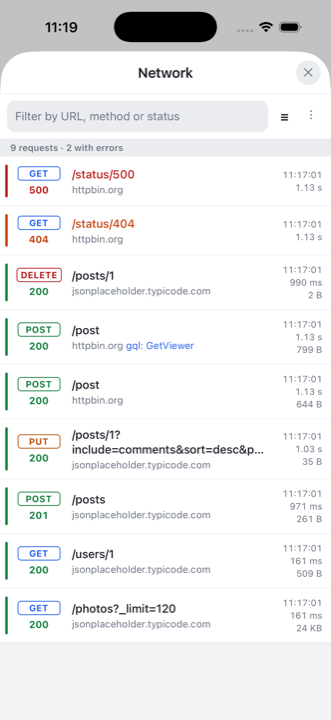
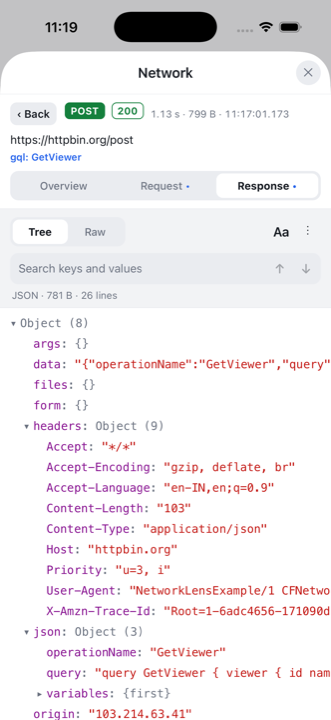
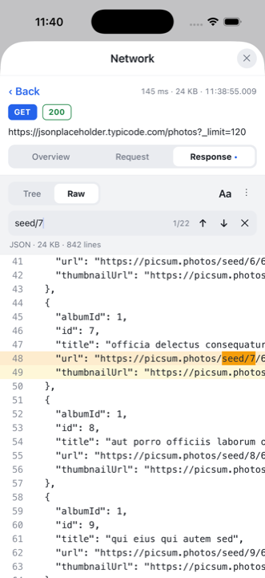
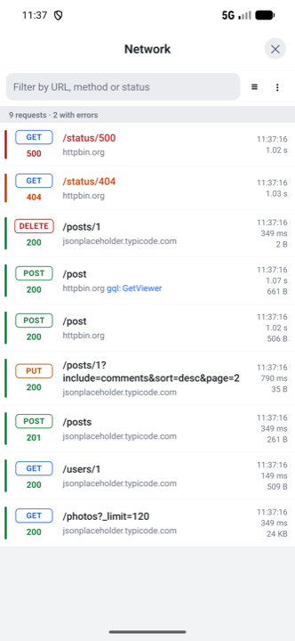
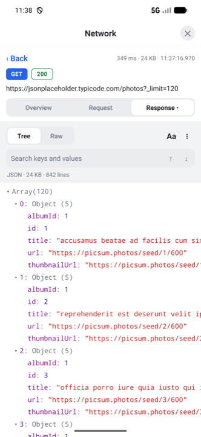
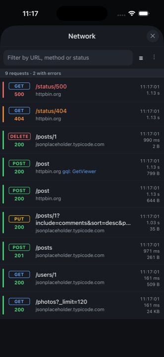
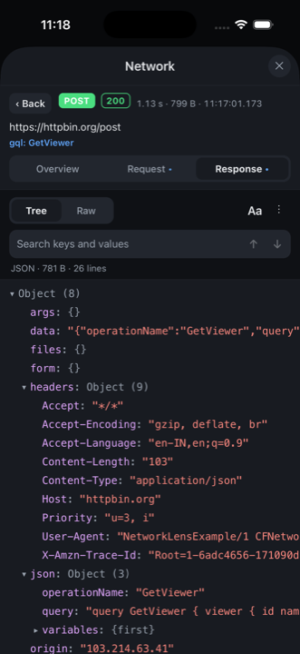

<h1 align="center">react-native-network-lens</h1>

<p align="center">
  <strong>See every request your React Native app makes, right on the phone.</strong><br />
  Tabbed request details · collapsible JSON tree · search · zero dependencies
</p>

<p align="center">
  <a href="https://www.npmjs.com/package/react-native-network-lens"></a>
  <a href="https://bundlephobia.com/package/react-native-network-lens"></a>
  <a href="https://www.npmjs.com/package/react-native-network-lens?activeTab=dependencies"></a>
  <a href="https://github.com/stainsmjohnson/react-native-network-lens/actions/workflows/ci.yml"></a>
  
  
  <a href="./LICENSE"></a>
</p>

<p align="center">
  <a href="https://github.com/stainsmjohnson/react-native-network-lens/stargazers"></a>
</p>

An in-app HTTP inspector for React Native that is actually usable on a phone
screen. Drop in one component, fire your requests, tap the floating button and
read JSON like you would in Chrome DevTools: expand the object you care about,
collapse the noise, search for a key, scroll sideways instead of fighting
wrapped text.

No native code, no Flipper, no desktop app, no debug build required. It works
in release builds too, so testers and QA can inspect traffic and share a cURL
or HAR with you from the device itself.

## Screenshots

<p align="center">
  
  
  
  
</p>
<p align="center">
  
  
  
  
</p>

## Why another network logger?

[`react-native-network-logger`](https://github.com/alexbrazier/react-native-network-logger)
proved that an in-app, zero-dependency inspector is the right idea. This
library keeps that idea and rebuilds the UI for small screens.

| | react-native-network-lens | react-native-network-logger | Flipper / Reactotron |
| --- | :---: | :---: | :---: |
| Works on device, no desktop app | ✅ | ✅ | ❌ |
| Works in release builds | ✅ | ✅ | ❌ |
| Zero dependencies, no native code | ✅ | ✅ | ❌ |
| Separate tabs for headers, request, response | ✅ | ❌ | ✅ |
| Collapsible JSON tree (console style) | ✅ | ❌ | ✅ |
| Horizontal scrolling, no wrapped JSON | ✅ | ❌ | ✅ |
| Search inside a payload with next / previous | ✅ | ❌ | ✅ |
| Adjustable code font size | ✅ | ❌ | – |
| Failed / timed-out / aborted states | ✅ | ❌ | ✅ |
| Filter by method, status group, host | ✅ | partial | ✅ |
| Feature flag built in (`enabled`) | ✅ | ❌ | – |
| Floating overlay button | ✅ | ❌ | – |
| Light / dark / follows system | ✅ | light / dark | – |
| cURL and HAR export | ✅ | ✅ | ✅ |
| Supports React Native | 0.69+ | 0.60+ | varies |

## Features

**Capture**

- Intercepts `XMLHttpRequest`, which means `fetch`, axios, Apollo, Relay, RTK
  Query and every other JS networking library are covered.
- Records request and response headers, bodies, status, timing, size, and
  GraphQL operation names.
- Distinguishes pending, done, failed, timed out and aborted requests.
- Ring buffer with a configurable limit, pause/resume, and ignore rules by
  host, exact URL or regex.

**Inspect**

- Request list with colour-coded method and status, path/host split,
  duration, size and a live counter of requests with errors.
- Free-text filter plus chips for method, status group (2xx…5xx, pending,
  failed) and host.
- Details in three tabs: **Overview** (URL, timings, query parameters,
  request and response headers), **Request** body and **Response** body.
- Bodies render as a collapsible tree like the JavaScript console, or as
  pretty-printed raw text with line numbers. Both scroll horizontally and
  virtualise rows, so multi-megabyte payloads stay smooth.
- Search inside a body with match count and next / previous; the tree expands
  and scrolls to each hit.
- "Aa" button cycles the code font size. Long-press any tree node to copy or
  share just that value.

**Share**

- Share a body, the headers, a cURL command, the full request as JSON, or all
  requests as a HAR file that Chrome, Charles and Proxyman can import.
- Plug in your clipboard library with one prop to get Copy buttons everywhere.

**Integrate**

- `<NetworkLensOverlay />` adds a floating badge that opens the inspector in a
  modal. `<NetworkLens />` renders it inline inside your own screen.
- `enabled` flag on everything: wire it to `__DEV__`, a remote config value or
  a hidden developer setting.
- Light, dark or follow-the-system themes, fully overridable.
- Written in TypeScript, works with the New Architecture and the old one,
  survives Fast Refresh.

## Installation

```sh
yarn add react-native-network-lens
# or
npm install react-native-network-lens
```

No `pod install`, no Gradle changes, no Expo config plugin. Requires React
Native 0.69+ and React 18+.

## Quick start

```tsx
// index.js — as early as possible so nothing is missed
import { startNetworkLogging } from 'react-native-network-lens';

startNetworkLogging({ enabled: __DEV__ });
```

```tsx
// App.tsx
import { NetworkLensOverlay } from 'react-native-network-lens';

export default function App() {
  return (
    <>
      <RootNavigator />
      <NetworkLensOverlay enabled={__DEV__} />
    </>
  );
}
```

Tap the floating **NET** button. It shows how many requests were captured and
turns red when something failed.

## Recipes

### As a screen in your navigator

```tsx
import { NetworkLens } from 'react-native-network-lens';

const NetworkScreen = () => <NetworkLens />;
```

`NetworkLens` fills its parent (`flex: 1`) and handles the Android hardware
back button for the details view. To make your own header back button step
out of the details view first:

```tsx
import { NetworkLens, getBackHandler } from 'react-native-network-lens';

const NetworkScreen = ({ navigation }) => {
  const onBack = getBackHandler(navigation.goBack);
  return (
    <>
      <Header onBackPress={onBack} />
      <NetworkLens />
    </>
  );
};
```

### Behind a feature flag or hidden gesture

```tsx
const inspectorEnabled = __DEV__ || remoteConfig.getBoolean('network_inspector');

startNetworkLogging({ enabled: inspectorEnabled });

<NetworkLensOverlay enabled={inspectorEnabled} />
```

Prefer your own trigger (shake gesture, dev menu, tapping the version label
seven times)? Hide the button and control the sheet yourself:

```tsx
const [open, setOpen] = useState(false);

<NetworkLensOverlay hideButton visible={open} onVisibleChange={setOpen} />
```

### Copy buttons

The library ships no native code, so clipboard access is opt-in:

```tsx
import Clipboard from '@react-native-clipboard/clipboard';

<NetworkLensOverlay copyToClipboard={Clipboard.setString} />
```

### Expo

Works in Expo Go and development builds without a config plugin. Call
`startNetworkLogging()` at the top of your root layout or `App.tsx`.

### Keeping noise out

```tsx
startNetworkLogging({
  ignoredHosts: ['localhost:8081', 'firebaselogging.googleapis.com'],
  ignoredPatterns: [/^HEAD /, /\/analytics\//],
  maxRequests: 300,
});
```

### Alongside Reactotron, Flipper or Sentry

Other tools also patch `XMLHttpRequest`. react-native-network-lens patches on
top of whatever is already there and restores it on `stopNetworkLogging()`,
so they can run together.

### Using the data yourself

```tsx
import { useNetworkRequests, createHar } from 'react-native-network-lens';

const FailedCount = () => {
  const requests = useNetworkRequests();
  return <Text>{requests.filter((r) => r.state === 'failed').length}</Text>;
};

const har = await createHar(getRequests());
```

## API

### `startNetworkLogging(options?)`

| Option            | Type       | Default | Description |
| ----------------- | ---------- | ------- | ----------- |
| `enabled`         | `boolean`  | `true`  | Master switch. `false` makes the call a no-op and stops a running logger. |
| `maxRequests`     | `number`   | `500`   | Ring-buffer size. |
| `ignoredHosts`    | `string[]` |         | Hosts to skip, e.g. `['localhost:8081']`. |
| `ignoredUrls`     | `string[]` |         | Exact URLs to skip. |
| `ignoredPatterns` | `RegExp[]` |         | Tested against `"${method} ${url}"`. |
| `refreshRate`     | `number`   | `50`    | UI update throttle in ms. |

Also exported: `stopNetworkLogging()`, `isNetworkLoggingEnabled()`,
`getRequests()`, `clearRequests()`, `setNetworkLoggingPaused(bool)`,
`getBackHandler(fn)`, `createHar(requests)`.

### `<NetworkLens />`

| Prop              | Type                                              | Default  |
| ----------------- | ------------------------------------------------- | -------- |
| `enabled`         | `boolean`                                         | `true`   |
| `theme`           | `'light' \| 'dark' \| 'auto' \| Partial<Theme>`   | `'auto'` |
| `sort`            | `'asc' \| 'desc'`                                 | `'desc'` |
| `compact`         | `boolean`                                         | `false`  |
| `maxRows`         | `number`                                          |          |
| `copyToClipboard` | `(text: string) => void`                          |          |

A `ref` exposes `goBack(): boolean`, which returns from the details view to
the list (handy for your own back button or a modal's `onRequestClose`).

### `<NetworkLensOverlay />`

All `NetworkLens` props plus:

| Prop                          | Type                                                           | Default          |
| ----------------------------- | -------------------------------------------------------------- | ---------------- |
| `position`                    | `'bottom-right' \| 'bottom-left' \| 'top-right' \| 'top-left'` | `'bottom-right'` |
| `offset`                      | `{ x?: number; y?: number }`                                   | `{ x: 16, y: 32 }` |
| `visible` / `onVisibleChange` | controlled visibility of the sheet                             |                  |
| `hideButton`                  | `boolean`                                                      | `false`          |
| `title`                       | `string`                                                       | `'Network'`      |

### Hooks and building blocks

- `useNetworkRequests()` – live array of `NetworkRequest` objects, newest first.
- `useLoggerEnabled()`, `useLoggerPaused()`.
- `JsonTreeView` – the collapsible JSON viewer, reusable in your own debug UI.

### Theming

```tsx
<NetworkLens theme={{ colors: { primary: '#ff5c8a', jsonKey: '#ffd166' } }} />
```

Colours you omit fall back to the light or dark theme depending on the system
appearance. `theme.sizes.codeFontSize` (default 14) sets the base code size;
users can still cycle small / medium / large with the **Aa** button. See
`Theme` in `src/theme.ts` for every token.

## Compatibility

| | |
| --- | --- |
| React Native | 0.69 and newer (CI builds the example on the latest release) |
| React | 18 and newer |
| Architecture | New Architecture and legacy, Hermes and JSC |
| Expo | Expo Go and development builds, no config plugin |
| Platforms | iOS, Android. Web is untested. |

## How it works

`startNetworkLogging()` patches `XMLHttpRequest.prototype` (`open`,
`setRequestHeader`, `send`) and `stopNetworkLogging()` restores the originals.
Every callback is wrapped so a bug in the inspector can never break a request.
Captured requests live in one store on `globalThis`, which survives Fast
Refresh, and React reads it through `useSyncExternalStore`.

## Security

The inspector keeps captured headers and bodies in memory, including
authorization tokens and cookies, and lets the user share or export them.
Ship it behind `__DEV__` or an internal flag, and use `ignoredHosts` /
`ignoredPatterns` for endpoints that must never be captured. See
[SECURITY.md](SECURITY.md) for details and how to report issues.

## Migrating from `react-native-network-logger`

The public API is a superset: `startNetworkLogging`, `stopNetworkLogging`,
`getRequests`, `clearRequests`, `getBackHandler` and the default-exported
component keep working. Differences:

- `theme` accepts `'auto'` and defaults to it.
- `forceEnable` is gone; the interceptor coexists with other tools.
- Requests expose `state` (`pending | done | failed`) and `failureReason`
  (`error | timeout | abort`) instead of staying "pending" forever.
- Bodies are parsed into `{ kind: 'json' | 'form' | 'text' | 'binary' | 'empty' }`
  via `request.getRequestBody()` / `await request.getResponseBody()`.

## FAQ

**Nothing shows up.** Call `startNetworkLogging()` before the first request,
ideally at the top of `index.js`, and make sure `enabled` is not `false`.

**Can I ship it to production?** Yes, behind a flag. The library is small and
inert when `enabled` is `false`. Read the Security section first.

**Does it see native networking (Image, video, native SDKs)?** No. Only
requests that go through JavaScript's `XMLHttpRequest`, which is everything
your JS code sends.

## Contributing

Issues and pull requests are welcome. See the
[contributing guide](CONTRIBUTING.md); the example app in `example/` fires a
variety of requests (large JSON, nested objects, forms, GraphQL-like, errors,
timeouts, binary) so every screen can be tried in a minute.

If this library saves you time, a ⭐ on GitHub helps others find it.

## License

MIT © [Stains M Johnson](https://github.com/stainsmjohnson)
