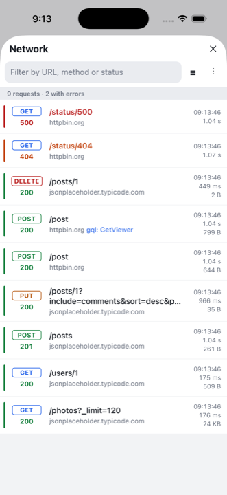
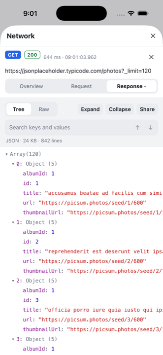
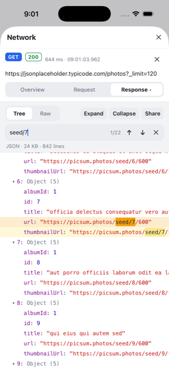
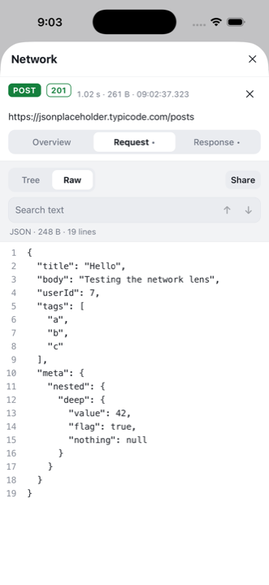

# react-native-network-lens

[](https://www.npmjs.com/package/react-native-network-lens)
[](https://github.com/stainsmjohnson/react-native-network-lens/actions/workflows/ci.yml)
[](./LICENSE)

In-app HTTP inspector for React Native, built for small screens.

| Request list | JSON tree | Search | Raw view |
| --- | --- | --- | --- |
|  |  |  |  |

A modern take on `react-native-network-logger`: the same zero-dependency XHR
capture (so `fetch`, `axios`, Apollo, etc. are all covered), with a UI that is
actually usable on a phone:

- **Tabbed request details** – *Overview* (URL, timings, query params, request
  and response headers), *Request* payload and *Response* payload each get the
  full screen instead of a 300 px box.
- **Collapsible JSON tree** – payloads render like the JavaScript console:
  expand only the object you care about, collapse the noise, long-press a node
  to copy or share it.
- **No line wrapping** – both the tree and the pretty-printed *Raw* view scroll
  horizontally, so indentation and structure stay readable.
- **Search inside payloads** – with match count and next/previous navigation
  that auto-expands and scrolls to the hit. Works in both Tree and Raw views.
- **Better list** – colour-coded method and status, path/host split, duration,
  size, GraphQL operation names, pending spinners, failed/timed-out/aborted
  states, filters by method / status group / host, and a free-text filter.
- **Feature flag built in** – `startNetworkLogging({ enabled })` and the
  `enabled` prop on every component turn the whole thing into a no-op, so it
  can be driven by `__DEV__`, a remote config value or a hidden dev setting.
- **Floating overlay** – `<NetworkLensOverlay />` adds a badge button that opens
  the inspector in a modal. One line, done.
- **Light / dark / auto themes**, cURL export, HAR export, share full request.
- **Zero dependencies**, pure TypeScript, no native code. Works with the New
  Architecture and React Native **0.83+**.

## Installation

```sh
yarn add react-native-network-lens
# or
npm install react-native-network-lens
```

No pod install, no Gradle changes.

## Quick start

```tsx
// index.js – as early as possible so nothing is missed
import { startNetworkLogging } from 'react-native-network-lens';

startNetworkLogging({ enabled: __DEV__ });
```

```tsx
// App.tsx – the one-liner overlay
import { NetworkLensOverlay } from 'react-native-network-lens';

export default function App() {
  return (
    <>
      <RootNavigator />
      <NetworkLensOverlay enabled={__DEV__} />
    </>
  );
}
```

Tap the floating **NET** button to open the inspector. It shows the number of
captured requests and turns red when something failed.

### Rendering it as a screen instead

```tsx
import { NetworkLens } from 'react-native-network-lens';

const NetworkScreen = () => <NetworkLens theme="dark" />;
```

`NetworkLens` fills its parent (`flex: 1`). Put it inside your own screen /
navigator; it handles the Android hardware back button for the details view.

### Conditionally enabling (feature flag)

Everything respects a single flag:

```tsx
const inspectorEnabled = __DEV__ || remoteConfig.getBoolean('network_inspector');

startNetworkLogging({ enabled: inspectorEnabled });

<NetworkLensOverlay enabled={inspectorEnabled} />
```

When `enabled` is `false`, `XMLHttpRequest` is left untouched and the
components render `null`. You can also call `stopNetworkLogging()` at runtime
to turn it off and free the captured data.

## API

### `startNetworkLogging(options?)`

| Option            | Type       | Default | Description |
| ----------------- | ---------- | ------- | ----------- |
| `enabled`         | `boolean`  | `true`  | Master switch. `false` makes the call a no-op (and stops a running logger). |
| `maxRequests`     | `number`   | `500`   | Ring-buffer size. |
| `ignoredHosts`    | `string[]` |         | Hosts to skip, e.g. `['localhost:8081']`. |
| `ignoredUrls`     | `string[]` |         | Exact URLs to skip. |
| `ignoredPatterns` | `RegExp[]` |         | Tested against `"${method} ${url}"`. |
| `refreshRate`     | `number`   | `50`    | UI update throttle in ms. |

Other functions: `stopNetworkLogging()`, `isNetworkLoggingEnabled()`,
`getRequests()`, `clearRequests()`, `setNetworkLoggingPaused(bool)`,
`getBackHandler(fn)` and `createHar(requests)`.

### `<NetworkLens />`

| Prop                 | Type                                   | Default      |
| -------------------- | -------------------------------------- | ------------ |
| `enabled`            | `boolean`                              | `true`       |
| `theme`              | `'light' \| 'dark' \| 'auto' \| Partial<Theme>` | `'auto'` |
| `sort`               | `'asc' \| 'desc'`                      | `'desc'`     |
| `compact`            | `boolean`                              | `false`      |
| `maxRows`            | `number`                               |              |
| `copyToClipboard`    | `(text: string) => void`               |              |
| `header`             | `ReactNode` rendered above the search bar |           |

A `ref` gives you `goBack(): boolean`, which returns from the details view to
the list. Use it to wire your own back button or modal `onRequestClose`.

The library ships no native code, so there is no clipboard access by default.
Pass your clipboard function to get **Copy** buttons everywhere:

```tsx
import Clipboard from '@react-native-clipboard/clipboard';

<NetworkLensOverlay copyToClipboard={Clipboard.setString} />
```

### `<NetworkLensOverlay />`

All `NetworkLens` props plus:

| Prop              | Type                                                        | Default          |
| ----------------- | ----------------------------------------------------------- | ---------------- |
| `position`        | `'bottom-right' \| 'bottom-left' \| 'top-right' \| 'top-left'` | `'bottom-right'` |
| `offset`          | `{ x?: number; y?: number }`                                | `{ x: 16, y: 32 }` |
| `visible` / `onVisibleChange` | controlled visibility of the modal              |                  |
| `hideButton`      | `boolean` – open it from your own dev menu instead          | `false`          |
| `title`           | `string`                                                    | `'Network'`      |

### Hooks and building blocks

- `useNetworkRequests()` – live array of `NetworkRequest` objects.
- `useLoggerEnabled()`, `useLoggerPaused()`.
- `JsonTreeView` is exported so you can reuse the collapsible JSON viewer
  elsewhere in your debug tooling.

### Theming

```tsx
<NetworkLens theme={{ colors: { primary: '#ff5c8a', jsonKey: '#ffd166' } }} />
```

Any colour you omit falls back to the light or dark theme depending on the
system appearance. See `Theme` in `src/theme.ts` for every token.

## How it works

The library patches `XMLHttpRequest.prototype` (`open`, `setRequestHeader`,
`send`) when `startNetworkLogging()` runs and restores the originals on
`stopNetworkLogging()`. Every callback is wrapped so a bug in the inspector can
never break a request. Captured requests live in a single store on
`globalThis`, which survives Fast Refresh, and React reads it through
`useSyncExternalStore`. There is no native code, so nothing to link.

## Security

The inspector keeps captured headers and bodies in memory, including
authorization tokens and cookies, and lets the user share or export them.
Ship it behind `__DEV__` or an internal flag only, and use `ignoredHosts` /
`ignoredPatterns` for endpoints that must never be captured. See
[SECURITY.md](SECURITY.md) for details and how to report issues.

## Migrating from `react-native-network-logger`

The public API is a superset: `startNetworkLogging`, `stopNetworkLogging`,
`getRequests`, `clearRequests`, `getBackHandler` and the default-exported
component keep working. Differences:

- `theme` accepts `'auto'` and defaults to it.
- Requests expose `state` (`pending | done | failed`) and `failureReason`
  (`error | timeout | abort`) instead of staying "pending" forever.
- Bodies are parsed into `{ kind: 'json' | 'form' | 'text' | 'binary' | 'empty' }`
  via `request.getRequestBody()` / `await request.getResponseBody()`.

## Contributing

See the [contributing guide](CONTRIBUTING.md). The example app in `example/`
fires a variety of requests (large JSON, nested objects, forms, GraphQL-like,
errors, timeouts, binary) so you can try every screen.

## License

MIT
